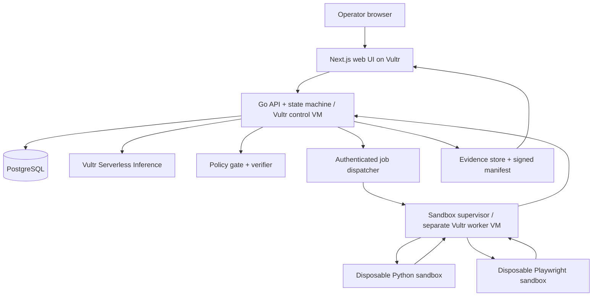

# RUKSA — Work Done. Proof Attached.

> **Status:** Pre-implementation specification / hackathon planning. **No running service or deployed application is claimed.**

RUKSA is a **proof-carrying autonomous operations agent**. It plans and executes real procurement-reconciliation work inside isolated Vultr sandboxes, checks its findings with deterministic rules, and returns an auditable evidence bundle. Human approval remains mandatory for any downstream business-changing action.

**Hackathon:** [Vultr: Agent Rush Hackathon](https://lablab.ai/ai-hackathons/vultr-hackathon) (3–8 November 2026)  
**Primary challenge:** Blast Radius Zero · **Secondary business domain:** procurement / finance operations  
**Submission cutoff:** 2026-11-08 22:00 UTC / 2026-11-09 05:00 WIB (verify on event dashboard)  
**Maintainer:** [@YanIanZ](https://github.com/YanIanZ) · **License:** MIT

## Why this exists

An AI agent can confidently claim to have reconciled invoices without showing what it ran, which records it checked, or whether its calculations are sound. RUKSA changes the acceptance criterion: **a task is not verified merely because a model says it is**. A verifiable completion requires a recorded plan, sandbox execution metadata, independently checked results, cited source rows, and an integrity-protected evidence manifest.

### First use case: autonomous procurement reconciliation

1. Operator uploads synthetic purchase orders, supplier invoices and optionally a mock vendor portal URL.
2. The Vultr Inference-powered planner produces typed, policy-constrained steps.
3. A Go control plane queues tasks for disposable Python and Playwright sandbox workers.
4. Rules compare invoice price and quantity against the purchase order; suspicious duplicate IDs and unknown purchase orders are flagged.
5. The verifier independently recalculates monetary differences from canonical input data and binds findings to evidence.
6. Operator reviews findings and can approve a **draft** corrective action; MVP does not transmit funds, change ERP records or send real vendor communications.

## Why Vultr is essential

| Component | Role | Event requirement |
|---|---|---|
| Vultr Cloud Compute VM (control plane) | Go API, orchestration, policy and verification, PostgreSQL | Required in both challenges |
| Vultr Serverless Inference | Every agent LLM call via OpenAI-compatible API | Required in Blast Radius Zero |
| Vultr Cloud Compute VM (worker) | Isolated, ephemeral code/browser execution | Isolated sandbox required; separate VM is our recommended design |
| Object storage (optional) | Persist sanitized evidence artifacts | Optional |

The official event mandates **actual sandboxed execution**, **Vultr-hosted backend**, **inference via Vultr Serverless Inference** for Challenge 1, a **public demo**, and a **recorded containment moment**. See [`docs/00-INDEX.md`](docs/00-INDEX.md) and the [official brief](https://lablab.ai/ai-hackathons/vultr-hackathon).

## Target architecture



**Security truth:** containers, even rootless, share a host kernel. They reduce blast radius, but do **not** prove absolute zero risk. Threat assumptions and hardening controls live in [`docs/06-SECURITY-THREAT-MODEL.md`](docs/06-SECURITY-THREAT-MODEL.md).

## Repository contents

- [`docs/01-PRD.md`](docs/01-PRD.md) — problem, personas, goals, scoped product requirements.
- [`docs/02-ARCHITECTURE.md`](docs/02-ARCHITECTURE.md) — components, trust zones and data flow.
- [`docs/03-TECHNICAL-SPEC.md`](docs/03-TECHNICAL-SPEC.md) — technology, domain flows, reliability and APIs.
- [`docs/04-API-CONTRACT.md`](docs/04-API-CONTRACT.md), [`schemas/openapi.yaml`](schemas/openapi.yaml) — endpoint and machine-readable contract.
- [`docs/05-DATA-MODEL.md`](docs/05-DATA-MODEL.md) — database schema and retention.
- [`docs/06-SECURITY-THREAT-MODEL.md`](docs/06-SECURITY-THREAT-MODEL.md) — attacker model and containment.
- [`docs/07-AGENT-ORCHESTRATION.md`](docs/07-AGENT-ORCHESTRATION.md), [`docs/08-EVIDENCE-PROTOCOL.md`](docs/08-EVIDENCE-PROTOCOL.md) — agent lifecycle and proof acceptance.
- [`docs/09-UX-UI.md`](docs/09-UX-UI.md) — pages and accessibility.
- [`docs/10-IMPLEMENTATION-ROADMAP.md`](docs/10-IMPLEMENTATION-ROADMAP.md), [`docs/11-BACKLOG.md`](docs/11-BACKLOG.md) — six-day plan and actionable tasks.
- [`docs/12-TEST-PLAN.md`](docs/12-TEST-PLAN.md), [`docs/13-DEPLOYMENT-OPERATIONS.md`](docs/13-DEPLOYMENT-OPERATIONS.md) — acceptance gates and runbook.
- [`docs/14-DEMO-AND-SUBMISSION.md`](docs/14-DEMO-AND-SUBMISSION.md), [`docs/20-PITCH-DECK.md`](docs/20-PITCH-DECK.md) — demo script and deck.
- Additional documents: business metrics, ADRs, fixtures, risk register, release criteria, privacy, competitor positioning, model evaluation.
- [`docs/24-OWNER-HANDOFF.md`](docs/24-OWNER-HANDOFF.md) — publishing instructions and honest current status.

## Quickstart (documentation / fixture checks only)

**The application is not implemented yet.** These commands validate deterministic synthetic test data; they do not run an AI agent or sandbox.

```bash
python3 scripts/validate_fixtures.py
python3 scripts/check_docs.py
```

See [`fixtures/synthetic/README.md`](fixtures/synthetic/README.md) for intentional anomalies and expected results. Runtime setup will be added **after implementation**, not presented as complete prematurely.

## Definition of Done for RUKSA 1.0

- [ ] Live product-style web app hosted on Vultr
- [ ] End-to-end real code execution in an isolated worker
- [ ] Vultr Inference used for all model-driven planning/explanation
- [ ] Deterministic verification of one complete procurement mission
- [ ] Source-to-finding evidence trail and exportable manifest
- [ ] Approval-gated follow-up draft
- [ ] Tested containment moment shown in recorded demo
- [ ] Public URL, documentation, video, slides and lablab submission

See the [`release checklist`](docs/19-RELEASE-CHECKLIST.md). Checkboxes intentionally start unchecked.

## Contributing and security

See [`CONTRIBUTING.md`](CONTRIBUTING.md), [`SECURITY.md`](SECURITY.md), and [`AGENTS.md`](AGENTS.md). Do not upload real invoices, personally identifiable information, secrets or customer records. Synthetic fixtures only. Third-party libraries must be license-compatible with MIT distribution.

## Official references

- https://lablab.ai/ai-hackathons/vultr-hackathon
- https://lablab.ai/ai-hackathons/vultr-hackathon/live
- https://community.vultr.com/e/vultr-agent-rush-hackathon
- https://docs.vultr.com/how-to-set-up-agent-sandboxing-on-vultr-cloud-compute
