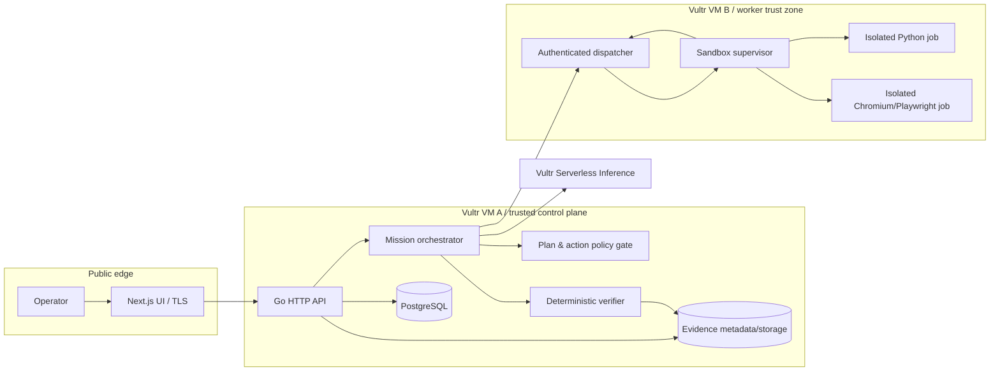
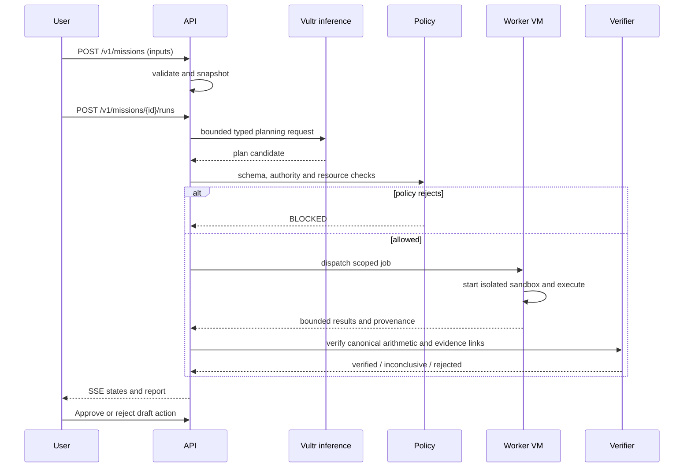

# System Architecture — RUKSA

**Target environment:** Vultr Cloud Compute. **Current state:** Design only.

## 1. Component topology

### Trust boundaries

- **TB1 Operator -> API:** all inputs untrusted; enforce quotas, limits, idempotency and typed validation.
- **TB2 Model -> orchestrator:** model output is untrusted planning advice, never executable administrative authority.
- **TB3 Orchestrator -> worker:** immutable job envelope with signed job ID, allowed tool, expiry and resource policy; authenticated channel.
- **TB4 Worker -> verifier:** stdout, JSON results and screenshots are untrusted evidence until revalidated.
- **TB5 Vendor page -> browser:** all website content and prompts from DOM are data, not instructions; policy gate blocks escalations.

## 2. Physical design

**VM A — control plane:** reverse proxy TLS; Next.js build; Go API; PostgreSQL; job scheduler; signed evidence metadata. Port 443 public; database and management only on private network. No container engine privileged socket exposed to web handlers. Minimum viable two-host layout recommended.

**VM B — execution plane:** worker supervisor with dedicated limited credentials, hardened container runtime, seccomp/AppArmor where supported, per-job cgroups, strict network policies. Agent processes never obtain VM A credentials or Vultr API key. Inbound worker dispatcher access limited to VM A via private network and mutual auth or equivalent signed short-lived authorization.

**Vultr Serverless Inference:** all agent planner/explainer calls use `https://api.vultrinference.com/v1`; key stored only in VM A. Model name selected at deployment based on current available list, not hardcoded in published material.

## 3. Data flow

1. Upload lands in quarantine/staging; validate extension, MIME, size and row schema; calculate SHA-256.
2. Snapshot input source files and derive normalized immutable records.
3. Mission orchestrator constructs sanitized task context; sends it to Vultr Inference.
4. Plan schema parser rejects unknown tool IDs, unknown fields, over-cap steps or unbounded loops.
5. Policy gate checks destination allowlist, job expiry, CPU/memory/time budget and approval requirements.
6. Control plane dispatches job with **data handles**, not secrets; worker fetches only scoped sanitized inputs via short-lived read-only link or authenticated access.
7. Worker executes isolated code and/browser; returns exit status, bounded stdout, artifact descriptors and payload checksums.
8. Control plane recomputes deterministic invariants against original snapshots. Unverified findings are not promoted.
9. Evidence store records origin, hash, trace chain, policy decision, execution metadata and verifier result; manifest signed with control-plane-only key.
10. UI reads results and displays approval of proposed draft actions. No direct financial transaction in v1.

## 4. Mission sequence

## 5. Reliability strategy

- PostgreSQL transaction encloses state transitions, job receipt and event creation (outbox pattern if available).
- Every dispatch has idempotent `mission_id/run_id/step_id/attempt` key. Retried delivery must not duplicate external effects.
- Leases for executing steps expire; reaper marks orphaned runs and cleans containers.
- Cancellation is best effort and bounded; app state is not `CANCELED` until supervisor termination/cleanup reported or timeout policy has escalated.
- Model errors fail closed; use limited retry with exponential backoff and clear user-visible status.
- Evidence artifacts content-addressed by SHA-256; manifest references exact bytes, not mutable paths.

## 6. Observability

Structured JSON logs with `trace_id`, `mission_id`, `run_id`, `step_id`, `sandbox_id`, `policy_rule`, and `outcome`; Prometheus-style counters and latency histograms. Redact secret values and sensitive uploads. UI shows last-known state and reconnects to SSE with monotonically increasing event sequence.

## 7. Cost, scaling and limitations

During hackathon, use a fixed-size deployment and a strict concurrency quota (e.g., at most two simultaneous sandbox jobs). Measure inference tokens, VM hours and disk consumption. Avoid claiming autoscaling. A future design may move worker fleet to disposable VMs or stronger microVM runtime; container isolation alone is not equivalent to independent kernels.

## 8. Architectural acceptance tests

AT-01 secret never arrives in sandbox; AT-02 private network is blocked from browser; AT-03 60s loop is stopped; AT-04 run output integrity check catches modified evidence; AT-05 crashed worker leaves no perpetual running status; AT-06 duplicated dispatch does not produce duplicate findings.
