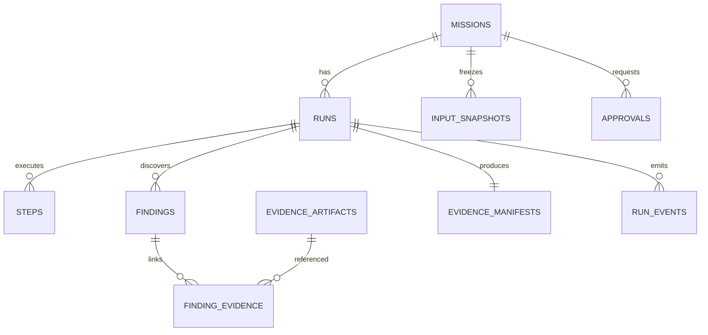

# Data Model and Persistence

**Storage:** PostgreSQL on control VM; evidence blobs via local restricted filesystem or Vultr Object Storage when configured. All data is synthetic for v1.

## Relationships

## Proposed tables

| Entity | Fields / type | Constraints and purpose |
|---|---|---|
| `missions` | `id uuid pk`, `session_id`, `title`, `objective`, `status`, `version int`, `dataset_id`, `created_at`, `updated_at` | DB check enum; optimistic concurrency |
| `input_snapshots` | `id`, `mission_id fk`, `source_name`, `sha256 char(64)`, `media_type`, `bytes bigint`, `blob_ref`, `created_at` | Immutable; raw source never edited |
| `runs` | `id`, `mission_id`, `attempt`, `status`, `started_at`, `ended_at`, `policy_version`, `plan_sha256`, `verifier_version`, `cleanup_complete bool` | Unique `(mission_id, attempt)`; one active run guard |
| `steps` | `id`, `run_id`, `sequence`, `tool`, `status`, `sandbox_id`, `timeout_seconds`, `started_at`, `ended_at`, `exit_code`, `termination_reason` | Unique `(run_id, sequence)` |
| `findings` | `id`, `run_id`, `type`, `severity`, `status`, `invoice_record_id`, `po_record_id`, `amount_cents nullable`, `currency`, `rule_id`, `explanation` | No verified without rule and evidence |
| `evidence_artifacts` | `id`, `run_id`, `artifact_type`, `origin`, `blob_ref`, `sha256`, `size_bytes`, `created_at`, `classification` | Content-addressed immutable artifacts |
| `finding_evidence` | `finding_id`, `artifact_id`, `source_locator`, `relation` | Primary key `(finding_id, artifact_id, source_locator)` |
| `evidence_manifests` | `run_id pk`, `schema_version`, `canonical_sha256`, `signature`, `signing_key_id`, `verifier_summary`, `issued_at` | Created only after integrity checks |
| `approvals` | `id`, `mission_id`, `action_type`, `action_payload_sha256`, `status`, `actor_session_id`, `resolved_at`, `expires_at` | Approval refers to exact action digest |
| `run_events` | `run_id`, `sequence`, `type`, `payload_json`, `created_at` | `(run_id,sequence)` unique; SSE replay |
| `idempotency_keys` | `key`, `scope`, `response_ref`, `expires_at` | Request dedupe for retries |

## Core constraints

- Foreign keys all enabled. Delete mission **does not** silently cascade evidence; implement retention/deletion transaction and audit event.
- `findings.amount_cents` is nullable for nonmonetary anomalies. For price variance it must be integer cents and associated with `currency=USD` in demo.
- `verifier_summary` stores independent verdict and rule version. `VERIFIED` requires `rule_id`, source snapshot reference, artifact hash match and a successful verifier record.
- `runs.status` cannot return from terminal state except via a new run row; no status rewriting to hide failures.
- Evidence append-only; content changes require new artifact IDs and a new signed manifest.
- `run_events.sequence` monotonically increases per run; duplicate dispatch idempotent.

## Database index plan

- `missions(session_id, created_at DESC)` for dashboard.
- `runs(mission_id, attempt DESC)` for run history.
- `findings(run_id, status, type)` for exception list.
- `run_events(run_id, sequence)` for SSE catch-up.
- `evidence_artifacts(sha256)` for integrity and storage reuse.
- `approvals(mission_id, status, expires_at)` for approval inbox.

## Optional fixture schema

Synthetic files in `fixtures/synthetic/`: `purchase_orders.csv`, `invoices.csv`, `expected_findings.json`; see [`17-DATASET-SPEC.md`](17-DATASET-SPEC.md). IDs do not imply real persons or businesses.

## Lifecycle and retention

- Default demo data retention target: 7 days for raw logs/artifacts, 30 days for aggregate metadata (configurable; **proposed**, not currently enforced).
- Delete evidence and input snapshots at TTL end, then clean dependent references in controlled order.
- Never store passwords, payment card details or real employee data in fixtures.
- Signed hashes protect integrity relative to signer trust; privileged control-plane compromise is outside that guarantee.

## Migration strategy

Use versioned sequential SQL migrations, gated on startup. Ensure zero long-lived transactions on request paths. Before structural changes, export a sanitized schema snapshot and run migration against disposable staging DB; do not rely on manual edits to production data.
