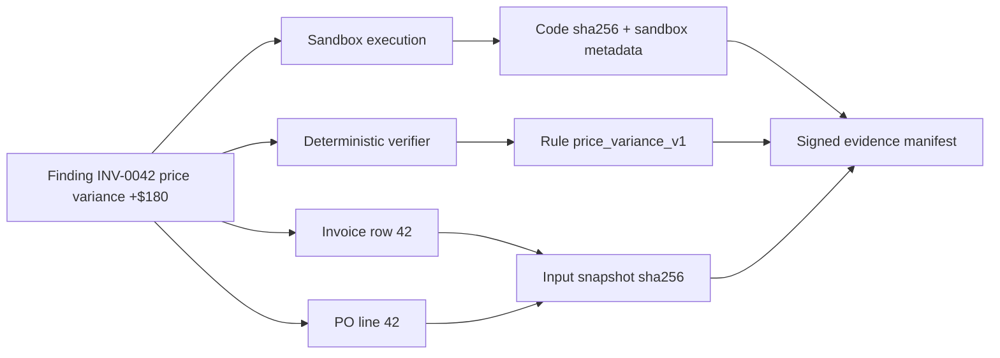

# SUPERSEDED — Historical RUKSA Concept (NOT CURRENT SCOPE)

> Current product is **RUKSA RELIC**, the Autonomous Digital Restoration Studio. See [active PRD](32-RELIC-PRD.md), [architecture](33-RELIC-ARCHITECTURE.md), and [security](36-RELIC-SECURITY.md). The text below is retained for historical reference and must not be used as RELIC implementation instructions.

---

# Evidence and Verification Protocol (EVP-1)

## 1. Goal

Make every `VERIFIED` finding traceable to **immutable inputs + actual executed work + independent checks**. Verified is a product status: evidence meets documented rules; it is not legal audit certification or assurance that cloud infrastructure is invulnerable.

## 2. Evidence categories

- `SOURCE_ROW`: canonical invoice/PO row locator and source file SHA-256.
- `EXECUTION`: sandbox image digest, tool ID, command/code SHA-256, start/end, exit code, resource limits, termination reason.
- `BROWSER_CAPTURE`: approved URL, final URL, timestamp, screenshot hash, extracted field hashes; never treat page instruction text as authority.
- `VERIFICATION`: deterministic rule ID/version, input references, expected/actual result in integer cents, pass/fail reason.
- `POLICY_DECISION`: checked policy version, permitted tools, destination and resource constraints.
- `ACTION_DRAFT`: proposed action payload and approval digest, never evidence of execution of that action.

## 3. Canonical evidence manifest

Machine-readable JSON schema: [`../schemas/evidence-manifest.schema.json`](../schemas/evidence-manifest.schema.json). Minimum fields: `schema_version`, `mission_id`, `run_id`, `input_sha256`, `plan_sha256`, `policy_version`, `verifier_version`, `artifacts[]`, `findings[]`, `execution_summary`, `issued_at`, `manifest_sha256`, `signature`, `signing_key_id`. The exact signing material is kept on VM A and withheld from sandboxes.

### Canonicalization procedure

1. Serialize manifest fields excluding the entire `integrity` object using one documented canonical JSON algorithm (recommend RFC 8785 JCS); ensure cross-language parity.
2. Compute SHA-256 of canonical bytes and sign with a control-plane asymmetric key (prefer Ed25519; public verifier key published separately).
3. Record manifest digest, signer key ID and signature. Each artifact independently has `sha256` and byte length.
4. Verifier reproduces canonicalization and validates signature, artifact bytes, required references and rule results.
5. Signature is issued **after** validation; never ask the model to invent cryptographic digests.

## 4. Finding proof requirements

**Price variance:** must bind (a) invoice source row and hash, (b) matching PO source row/hash, (c) execution trace and code hash, (d) independent verifier output. Verifier recomputes in cents: `(13800 - 12000) * 10 = 18000`; only then `VERIFIED`.

**Duplicate invoice:** pair-level finding binds both invoice record IDs and matching vendor ID / supplier invoice number. Label `possible_duplicate` rather than fraud or proven double payment.

**Unknown PO:** source row plus failed lookup in canonical PO index; status may be `VERIFIED` as a **reference mismatch** but not a proven financial loss.

## 5. Evidence Graph representation

## 6. Integrity vs truth

A valid manifest shows that bytes and metadata were not altered relative to a trusted signer. It **cannot** prove an upstream supplier portal is honest, that OCR is accurate, that a model explanation is correct, or that privileged control-plane administrators never forged evidence. User interface must distinguish `integrity_verified`, `business_rule_verified` and `source_authenticated` (the last may be unknown for mock portal content).

## 7. Negative acceptance scenarios

- Modify one byte of archived CSV: artifact digest check must fail.
- Swap PO row reference: verifier rejects incorrect linkage.
- Claim price delta $190: verifier rejects versus $180 independent computation.
- Remove execution output artifact: finding remains `INCONCLUSIVE`.
- Fake browser screenshot hash: manifest verification fails.
- Reuse signature against changed manifest: signature verification fails.
- Deny sandbox execution: manifest cannot mark run as executed successfully.

## 8. UI content rules

Display measured facts separately from model explanations. Every finding shows status, amount if known, source IDs and verifier rule. Provide a direct evidence drawer with file path/line, screenshot view if applicable and execution timeline. Never use green success badges for unverified or merely drafted actions.
